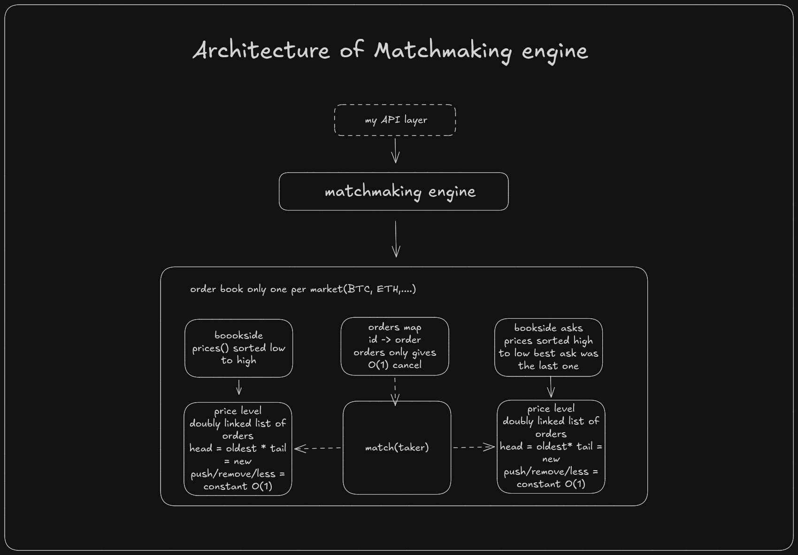
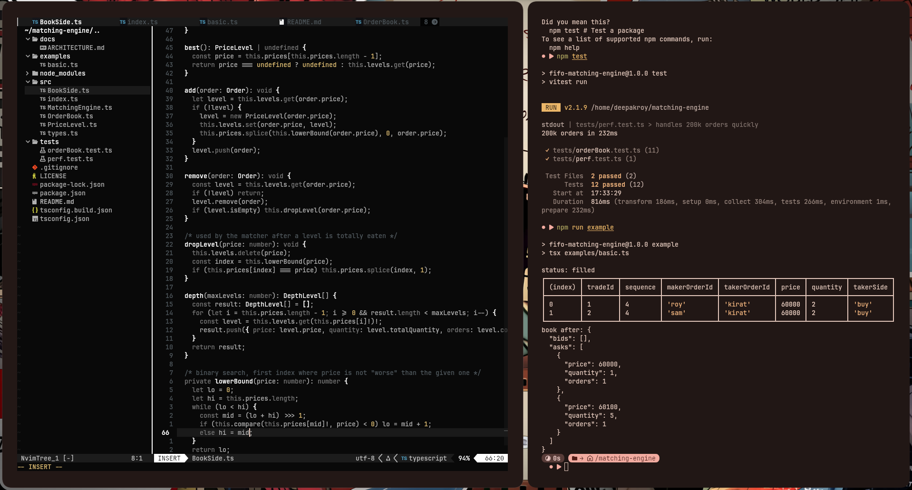

# FIFO matching engine

a small, fast and easy to read **price-time priority (fifo)** matching engine written in typescript.
good for learning, and a solid base for a cex or an off-chain order book of a dex.



## how matching works

1. **price priority**: best price goes first (highest bid, lowest ask).
2. **time priority**: at the same price, the order that came first gets filled first.
3. trades always happen at the **maker's price** (the order already resting in the book).

## features

- limit and market orders
- partial fills, cancel, depth snapshot
- multi-market support (`btc-usdt`, `eth-usdt`, ...)
- deterministic: uses a sequence counter, not `date.now()`, so same input = same output (great for replay and dex sequencers)
- zero runtime dependencies

## if you wannaaa run in your terminal ;)

```bash
npm install
npm test
npm run example
```

## important notes

- **use integers for price and quantity** (ticks and lots). floats cause rounding bugs in money code.
  example: price `60000.50` with tick size `0.01` becomes `6000050`.
- single-threaded by design. run one book per market and process orders one by one.

## complexity

| action              | cost                                   |
| ------------------- | -------------------------------------- |
| best bid / ask      | O(1)                                   |
| cancel order        | O(1) + O(log n) only if level is empty |
| add order (new)     | O(log n) search + array shift          |
| add order (old)     | O(1)                                   |
| match one fill      | O(1)                                   |

`n` = number of price levels (not orders).